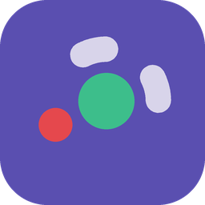
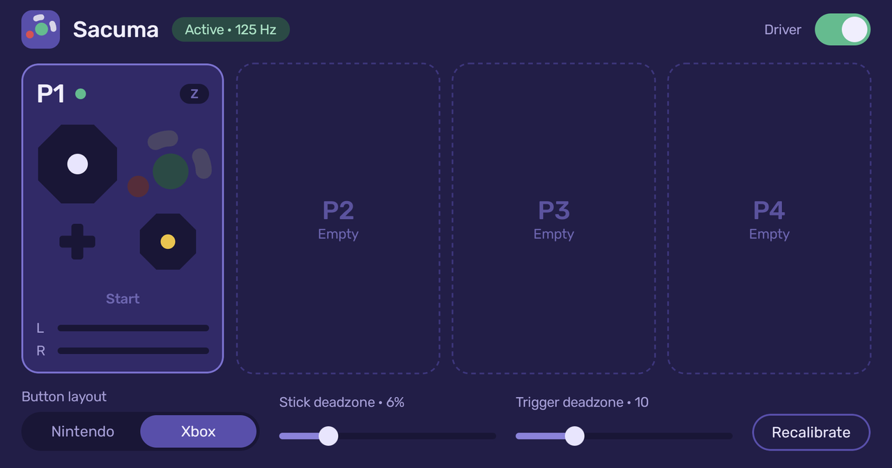

<p align="center">
  
</p>

<h1 align="center">Sacuma</h1>

<p align="center">
  Use your GameCube controllers on Android with the official Nintendo adapter.
</p>

<p align="center">
  <a href="https://github.com/AzizTw/sacuma/releases/latest"><b>Download the latest APK</b></a>
</p>

<p align="center">
  
</p>

## About

Sacuma is a simple app that makes the official GameCube controller adapter work on Android.
Every controller you plug into the adapter shows up as a regular gamepad, so any game or
emulator that supports controllers can use it.

It's inspired by [Delfinovin](https://github.com/Struggleton/Delfinovin), which does the same
thing on Windows.

You don't need any additional drivers, Sacuma is plug-and-play.

## Getting started

1. Download `Sacuma-x.y.z.apk` from the [latest release](https://github.com/AzizTw/sacuma/releases/latest) and install it.
2. Plug the adapter into your device.
3. When Android asks to open Sacuma, tick **Always** and allow it.

That's it. Your controllers now work in any game.

## Compatibility

- **Adapter:** the official Nintendo GameCube adapter (WUP-028). Plug in the black USB plug (The rumble feature is planned, so you won't benefit from plugging the grey USB currently).
- **Devices:** tested on the AYN Thor (Android 13). Sacuma creates its gamepads through
  Linux's `uinput`, which some gaming handhelds allow apps to use. Most stock phones don't
  allow it yet; support for those (with root) is planned.

## Building from source

You need JDK 17 and the Android SDK. Then:

```
./gradlew assembleDebug
```

The APK ends up in `app/build/outputs/apk/debug/`.

## Credits

- [Delfinovin](https://github.com/Struggleton/Delfinovin) for the inspiration
- [Rubik](https://github.com/googlefonts/rubik) font, under the SIL Open Font License

## License

[MIT](LICENSE)
